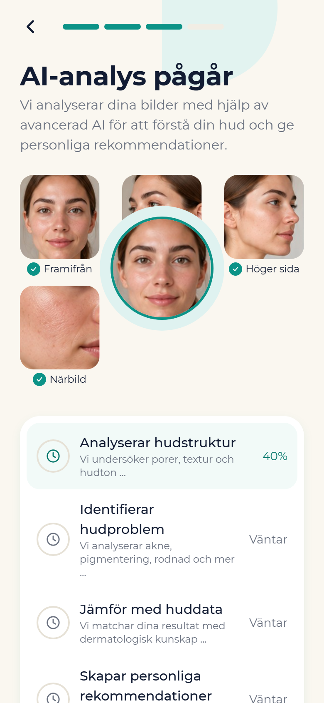
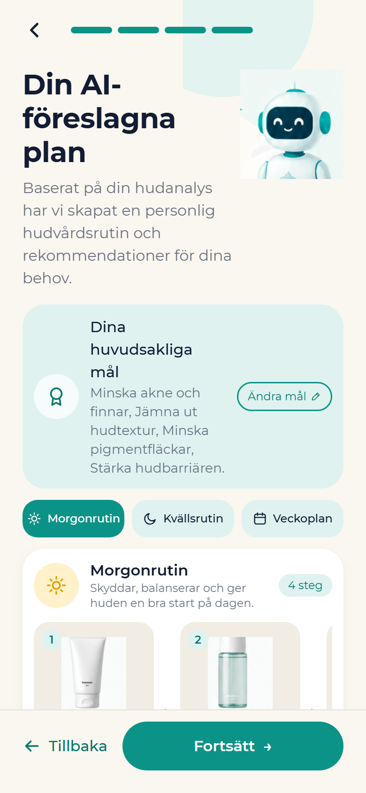

# Dermora – Web & Server

AI-powered guidance for facial skin problems: a short skin questionnaire, face photos and Google Gemini turn into personal skincare guidance and a routine you can follow.

**Live:** https://lightslategray-wallaby-444786.hostingersite.com

<p>
  
  
  
</p>

## About

Dermora is a school group project in the AI Developer programme at Jensen Education (Grupp 6). The app helps people with facial skin problems (acne, pigmentation, redness, dryness and similar) understand their skin. It combines a questionnaire, face photo analysis and an AI chat to give personal, non-medical skincare guidance, and it tells the user when to see a doctor or dermatologist.

The main mobile app lives in a separate repository: [anasnassan92-cmyk/dermora](https://github.com/anasnassan92-cmyk/dermora) (React Native + Expo, FastAPI, Supabase, Gemini).

This repository is the **web side** that runs as one Node.js app on Hostinger:

- the public landing page (Swedish)
- a project presentation page for the course
- privacy policy and terms of use
- the web build of the Expo app (`/app/`) with the questionnaire, photo upload, AI analysis, chat and plan flow
- the Node/Express API and the admin panel that the web app talks to

**Anas Alnaasan's role:** created the Dermora brand kit and visual identity (graphic profile, logo, icon set, patterns) and built this website. In the team split shown on the presentation page, he also owned authentication and the user profile (registration, login, e-mail verification, base profile). Dermora is a team project: the other modules (questionnaire, image upload, AI guidance, treatment plan, backend/database) were owned by other group members, as noted in the source file headers.

## Features

**Public website (`public/`)**
- Landing page (`index.html`): hero, problem, how it works, app walkthrough with screenshots, features, privacy/safety, FAQ and a beta sign-up form (`POST /api/beta`)
- Project presentation (`presentation.html`): problem, user journey, AI safety boundaries, release roadmap, team roles and tech stack
- Privacy policy (`integritet.html`) and terms of use (`villkor.html`)
- Self-hosted Montserrat fonts, SVG logo variants, an icon set and brand patterns
- Dependency-free JavaScript for the mobile menu and the beta form

**Web app (`public/app/`)**
- Prebuilt Expo web export of the Dermora app, served as a single-page app with fallback routing

**API (`/api`)**
- Auth: register, 6-digit e-mail verification code, resend, login, Google Sign-In (ID token), `me`
- Profile: read, update, delete account and all related data
- Questionnaire: versioned JSON definition with conditional follow-up questions and server-side answer validation
- Assessments: draft → submit → analyzed
- Images: upload with automatic EXIF/GPS stripping, rotation fix and resize; face check with Google Cloud Vision or a local sharpness/brightness fallback; private file access through short-lived signed URLs
- AI analysis: Google Gemini with JSON-schema output (skin type estimate, observations, severity, routine, red flags, `seek_care`), model fallback on 429/503/404, and a mock provider when no API key is set
- AI chat: normal and streaming (Server-Sent Events) replies, suggested follow-up questions, thumbs up/down feedback, and a per-user conversation memory summary
- Knowledge base: Swedish dermatology notes (`src/data/knowledge/*.md`) retrieved with BM25 (no embedding service) and added to the prompt as cited sources
- Treatment plans: create from an assessment, confirm, archive, get active plan
- Progress: daily morning/evening/weekly routine log, streak, 14-day adherence and follow-up check-ins
- Health endpoint (`/api/health`) that reports which integrations are active

**Admin panel (`/admin`)**
- Server-rendered pages for overview, users (with detail and delete), chats, care signals (`seek_care` flags), beta sign-ups, questionnaire and system status
- Access limited to e-mails in `ADMIN_EMAILS` or users with `is_admin`

## Tech stack

- **Runtime:** Node.js 20+ (built-in `node:sqlite` for local development), TypeScript, ES modules
- **Server:** Express 5, Zod, cookie-parser, Multer
- **Auth:** bcryptjs, jsonwebtoken, Google ID token verification
- **Database:** MySQL (mysql2) in production, SQLite locally, with versioned migrations
- **AI & images:** `@google/genai` (Gemini), Google Cloud Vision REST API, sharp
- **E-mail:** Nodemailer over SMTP
- **Frontend:** static HTML/CSS/vanilla JS, Expo web export
- **Hosting:** Hostinger Node.js Web App

## Project structure

```
dermora-web/
├── public/                  # Static site served by Express
│   ├── index.html           # Landing page
│   ├── presentation.html    # Course project presentation (Grupp 6)
│   ├── integritet.html      # Privacy policy
│   ├── villkor.html         # Terms of use
│   ├── css/ js/             # Landing page styles and scripts
│   ├── assets/              # Logo, icons, patterns, fonts, images, app screenshots
│   └── app/                 # Prebuilt Expo web app (SPA)
├── src/
│   ├── index.ts             # Express app: security headers, routers, static files, error handler
│   ├── config.ts            # Runtime config from environment variables + data folder
│   ├── auth/                # Password hashing, JWT, e-mail codes, Google tokens, rate limit
│   ├── routes/              # /api/auth and the app API
│   ├── admin/               # Server-rendered admin panel
│   ├── db/                  # MySQL/SQLite driver, schema + migrations, row mappers
│   ├── services/            # Gemini AI, knowledge retrieval, images, mailer, questionnaire
│   └── data/                # Questionnaire JSON + Swedish knowledge base (Markdown)
├── package.json
└── tsconfig.json
```

## Getting started

Requirements: Node.js 22+ recommended (the local SQLite driver uses the built-in `node:sqlite` module).

```bash
npm install
cp .env.example .env      # fill in what you need; everything is optional for a local demo
npm run dev               # tsx watch on http://localhost:4000
```

There is no separate migrate or seed step: the schema is created and migrated automatically on start.

- Without `DB_HOST` the server uses a local SQLite file in `.data/`.
- Without `GEMINI_API_KEY` the AI uses a mock provider.
- Without SMTP credentials the server runs in demo mode and returns the verification code to the app.
- Without `GOOGLE_VISION_API_KEY` the face check runs locally with sharp.

Production build:

```bash
npm run build
npm start                 # node dist/index.js
```

The `test` script expects a `test/` folder, which is not included in this repository.

Note that `.env` is not loaded automatically; on Hostinger the variables are set in the hosting panel. Locally, export them in your shell or run with `node --env-file=.env`.

## Security notes

- Passwords are hashed with bcrypt; e-mail codes are stored as SHA-256 hashes, expire after 15 minutes and lock after 5 failed attempts.
- The app uses JWTs (Bearer, 14-day lifetime); the admin panel uses a separate signed httpOnly, SameSite=Strict cookie.
- If `JWT_SECRET` is not set, a random secret is generated once on the server and stored outside the app folder.
- Auth endpoints are rate limited; all input is validated with Zod.
- Uploaded photos are stored outside the web root, stripped of EXIF/GPS data and only served through signed URLs that expire after 30 minutes. Face detection is used only to check photo quality, never for identification.
- Users can delete their account, which removes their profile, answers, photos, AI results, chats and plans.
- Basic security headers are set (`nosniff`, `Referrer-Policy`, `X-Frame-Options`); CORS is only enabled in development.
- No secrets are committed; see `.env.example` for the variable names.

## Built with AI-assisted development

Built by Anas Alnaasan with AI coding assistants (Claude/ChatGPT), with his own product thinking, design, prompting, code review, testing and deployment.

## Author

Anas Alnaasan · MIZA Group · https://mizagroup.se · https://github.com/anasnassan92-cmyk

---

Part of the Dermora group project (Jensen Education, Grupp 6). © the Dermora team.
